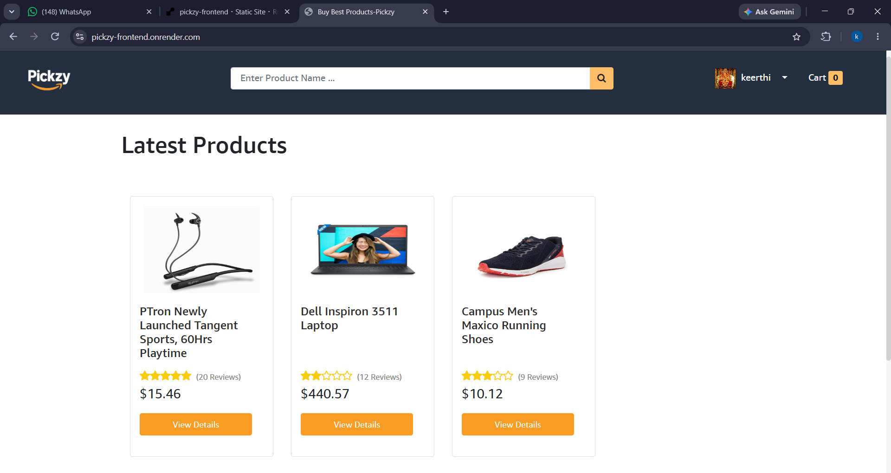
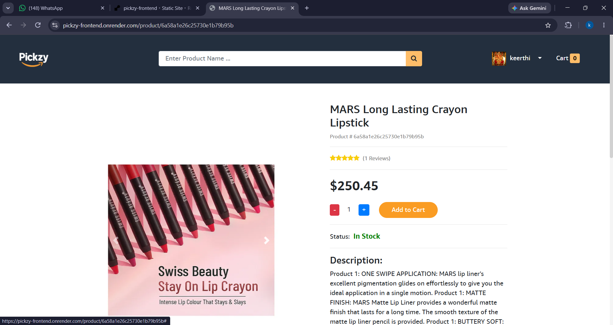
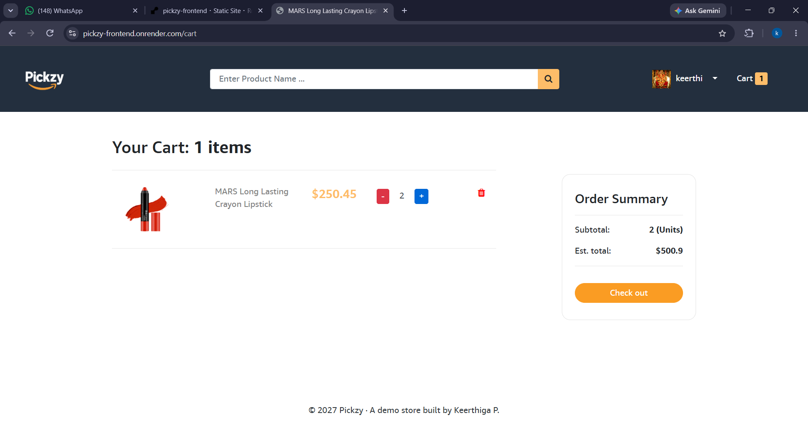
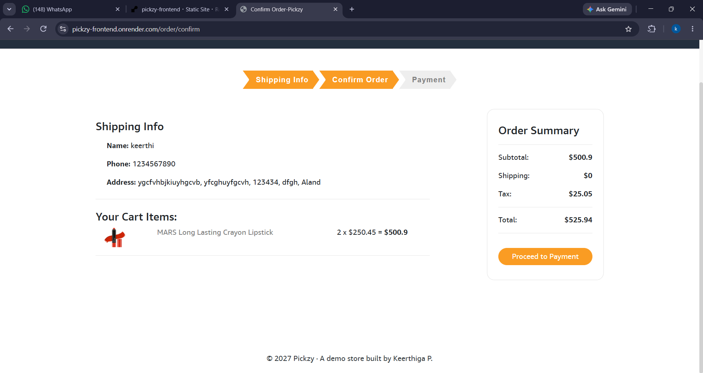
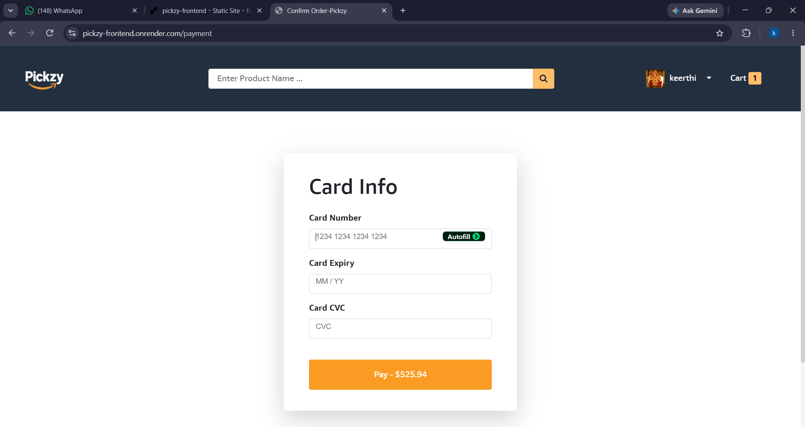
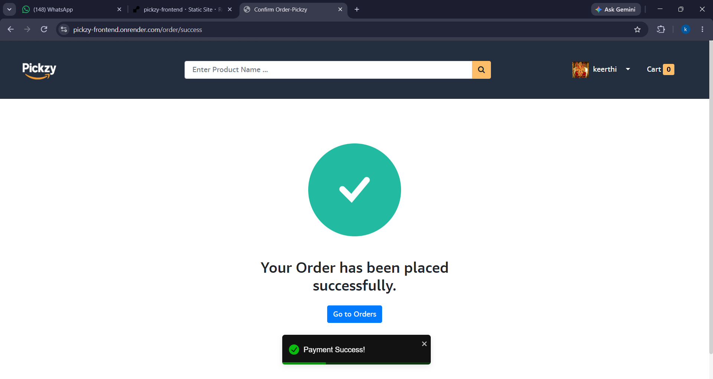
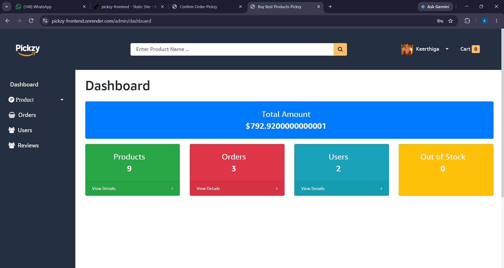
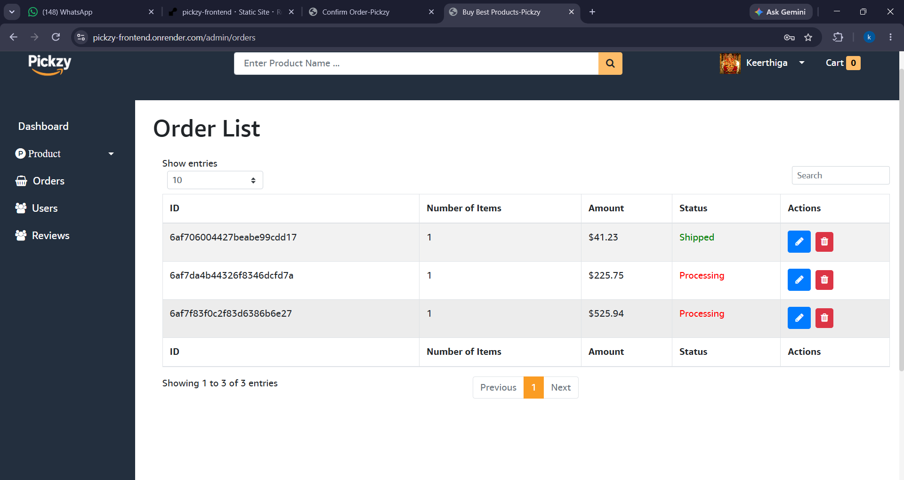
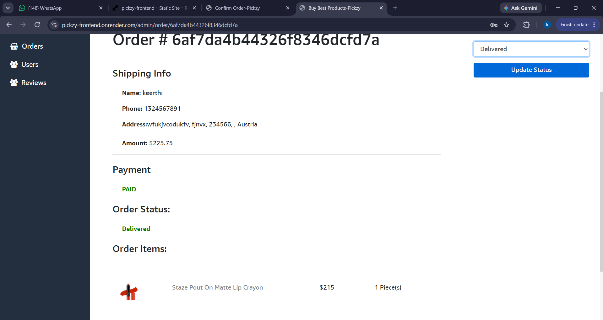

# Pickzy: MERN Stack E-Commerce App

An Amazon-inspired online store where users can browse and search products, add them to a cart, pay with Stripe (test mode) and track their orders. Admins manage products, orders, users and reviews from a dashboard.

**Live demo:** https://pickzy-frontend.onrender.com

> The demo runs on a free hosting plan, so it goes to sleep when nobody is using it. The first load can take up to a minute. Payments use Stripe **test mode**, so no real money is charged. Test card: `4242 4242 4242 4242`, any future expiry date, any 3-digit CVC.

## Screenshots

**Shopping**

| Home | Product details | Cart |
|---|---|---|
|  |  |  |

**Checkout**

| Confirm order | Card payment (Stripe) | Order placed |
|---|---|---|
|  |  |  |

**Admin dashboard**

| Dashboard | Order list | Update order status |
|---|---|---|
|  |  |  |

## Features

**Customers**
- Register and log in (JWT stored in a cookie), update profile and avatar
- Browse the latest products, product pages with image carousel, ratings, reviews and stock status
- Search by keyword and filter by category, price range and rating, with pagination
- Cart with quantity changes and remove, then shipping info, order confirmation and Stripe card payment
- "My Orders" page with order status (Processing, Shipped, Delivered)

**Admin**
- Dashboard with total sales, number of products, orders and users, and out-of-stock count
- Manage products, orders, users and reviews
- Update an order's status or delete an order

Order totals are calculated on the server: 5% tax, and shipping is $25 for small orders and free for larger ones.

## Tech stack

| Area | Tools |
|---|---|
| Frontend | React, Redux Toolkit, React Router, Bootstrap, Axios, React Toastify |
| Backend | Node.js, Express |
| Database | MongoDB Atlas with Mongoose |
| Auth | JSON Web Tokens, bcryptjs, cookie-parser |
| Payments | Stripe (test mode) |
| Other | Multer (image upload), Nodemailer, CORS, dotenv |
| Hosting | Render (static site for the frontend, web service for the backend) |

## Run it locally

You need Node.js, a MongoDB database (a free Atlas cluster works) and a Stripe account in test mode.

```bash
git clone https://github.com/keerthi723/pickzy.git
cd pickzy
npm install
npm install --prefix frontend
```

1. Copy `backend/config/config.env.example` to `backend/config/config.env` and fill in your own values (see the table below).
2. In `frontend/src/index.js`, set `axios.defaults.baseURL` to `http://127.0.0.1:8001` so the frontend talks to your local backend.
3. Load the sample products (optional):
```bash
npm run seeder
```
4. Start the backend (port 8001):
```bash
npm run dev
```
5. In a second terminal, start the frontend (port 3000):
```bash
npm start --prefix frontend
```

## Environment variables

Create `backend/config/config.env`. Never commit this file; it is listed in `.gitignore`.

| Name | Purpose |
|---|---|
| `PORT` | Backend port (8001) |
| `NODE_ENV` | `development` or `production` |
| `DB_LOCAL_URI` | MongoDB connection string |
| `JWT_SECRET` | Long random text used to sign login tokens |
| `JWT_EXPIRES_TIME` | Token lifetime, for example `7d` |
| `COOKIE_EXPIRES_TIME` | Cookie lifetime in days |
| `SMTP_HOST`, `SMTP_PORT`, `SMTP_USER`, `SMTP_PASS` | Email server settings |
| `SMTP_FROM_NAME`, `SMTP_FROM_EMAIL` | Sender name and address for emails |
| `BACKEND_URL` | Public address of the backend |
| `FRONTEND_URL` | Public address of the frontend (allowed by CORS) |
| `STRIPE_API_KEY` | Stripe publishable key (`pk_test_...`) |
| `STRIPE_SECRET_KEY` | Stripe secret key (`sk_test_...`) |

## Project structure

```
backend/
  config/        database connection and environment file
  controllers/   request handling logic
  middlewares/   authentication, roles, error handling
  models/        Mongoose schemas
  routes/        API routes
  utils/         helpers and the seeder script
frontend/
  src/
    actions/     API calls
    components/  pages and UI pieces
    slices/      Redux state
```

## Known limitations

- Free hosting: the site sleeps when idle, so the first request is slow.
- Uploaded images (profile pictures) are stored on the server's disk, which Render's free plan resets, so they can disappear. Product images that ship with the app are not affected.
- Payments run in Stripe test mode only, and the email settings point to a test mail service.

## What I learned

- Deploying a React frontend and an Express backend as two separate services, including CORS with cookies and the rewrite rule React Router needs on a static host
- Keeping secrets out of the repository with environment variables and `.gitignore`, and rotating keys after an accidental commit
- Accepting card payments with Stripe test mode
- Role-based access (user and admin) with JWT authentication
- Debugging live problems with browser developer tools and server logs

## Author

Keerthiga P · [LinkedIn](https://www.linkedin.com/in/keerthiga-p-29067b225) · keerthiga342@gmail.com
